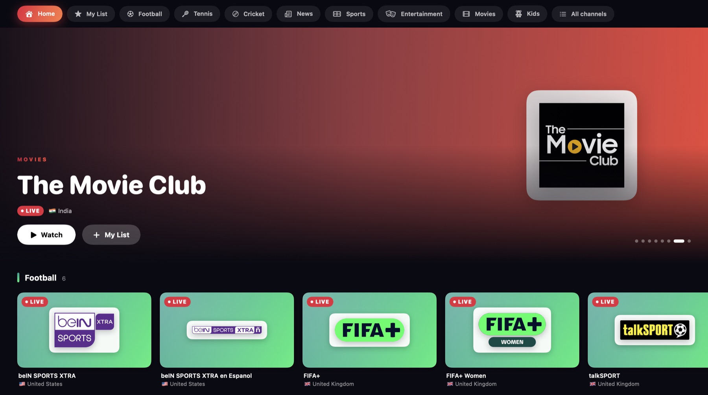

# Kaleido TV



Free live TV for Mac, iPhone and iPad, beautifully organised. Kaleido TV gathers legitimate free
channels into one dark, streaming-service style app: a rotating featured banner, category tabs, and
colourful rows of channel cards with logos and LIVE badges. It sorts channels into **Football, Tennis,
Cricket, News, Sports, Entertainment, Movies and Kids**, from a dozen countries or from the whole world,
and plays any paid IPTV service you add.

It's a native SwiftUI app. Video plays through **Apple's own player (AVFoundation)**, and there is
nothing third-party in it at all: no packages, and no frameworks beyond what ships with macOS and iOS.
One Xcode project builds both the Mac app (**macOS 14 Sonoma or later**) and the iPhone/iPad app
(**iOS 17 or later**).

Website: the page in [`docs/`](docs) (publish it with GitHub Pages: **Settings → Pages → `main` /
`docs`**).

## Run it on your Mac

You need **Xcode 16 or later** (free from the Mac App Store). No Apple ID or developer account is
needed for the Mac version.

**Easiest: build and install with one command.** In Terminal, from this folder:

```bash
./build-mac.sh
```

This builds the app and copies it to your **Applications** folder. After that, open **Kaleido TV**
from Launchpad or Spotlight like any other app, and drag it to the Dock if you want. Run the script
again whenever you change the code.

**Or from Xcode:** open `KaleidoTV.xcodeproj`, choose **My Mac** in the device menu at the top of the
window, and press **Run** (⌘R).

The first time you add a paid service after rebuilding, macOS may ask whether Kaleido TV can use its
saved item in your keychain. Click **Always Allow**. It asks because a locally built app's signature
changes with every build.

## Run it on your iPhone or iPad

You need a free Apple ID as well as Xcode.

1. Open `KaleidoTV.xcodeproj` in Xcode.
2. Click the **KaleidoTV** project in the left sidebar, then the **KaleidoTV** target, then
   **Signing & Capabilities**. Tick **Automatically manage signing** and choose your Apple ID under
   **Team** (Xcode → Settings → Accounts lets you add one).
3. If Xcode says the bundle identifier is taken, change `com.rajatjc.kaleidotv` to something of your
   own, such as `com.yourname.kaleidotv`.
4. Plug in your iPhone, pick it at the top of the Xcode window, and press **Run** (⌘R). If Xcode says
   the iOS platform isn't installed, install it from **Xcode → Settings → Components**.
5. The first time, the iPhone will refuse to open the app. Go to **Settings → General → VPN & Device
   Management**, tap your Apple ID and choose **Trust**.

With a free Apple ID the iPhone app stops opening after 7 days; press Run in Xcode again to renew it.
A paid Apple Developer account (or TestFlight) lasts a year.

## Using it

**Home** opens with a featured banner (it changes every few seconds; hover over it to pause), then a
row for each category: Recently watched, My List, Football, Tennis, Cricket, News, Sports,
Entertainment, Movies and Kids. Working channels come first in every row. Scroll a row sideways, or
on the Mac use the arrows that appear at its ends. **See all** opens the whole category.

| To… | On the Mac | On iPhone / iPad |
|---|---|---|
| Watch a channel | Click its card | Tap its card |
| Go back to the channels | The back button, or **Esc** (playback stops unless it's in Picture in Picture) | The back button |
| Open one category | The tabs along the top, or **See all** on a row | Same |
| Find a channel | **Search** in the toolbar (⌘F); searches every channel | Pull down and type in **Search** |
| Show one country only | The **globe** button in the toolbar (it lists every country that has channels, with its flag) | Same |
| Channels from every country | **Settings → Every country (worldwide)** | Same |
| Keep a channel in My List | **My List** on the banner or under the video, or right-click a card | Same, or press and hold a card |
| Full screen, Picture in Picture, AirPlay | The buttons on the video | Same |
| Stop | **Stop** under the video, or ⌘. | **Stop** under the video |
| Picture looks squashed or cropped | **Picture** under the video: Fit, Fill screen or Stretch. Remembered per channel | Same |
| Smoother playback on poor internet | **Kaleido TV → Settings…** (⌘,) **→ Buffer: Long** | **⋯ → Settings** |
| Re-check which channels work | The **✓** button in the toolbar (checks the open category) | Same |
| Add or remove a paid service | **Sources → Manage Sources…** (⇧⌘S) | **⋯ → Sources** |
| Reload every channel list | **Sources → Refresh All Channel Lists** (⌘R) | **⋯ → Refresh** |

The player screen shows the channel, what's on now and next (when there's a programme guide), and a
**More in…** row of similar channels: click one to switch straight to it.

When the app opens it checks, in the background, which free channels are working. It loads a real
piece of video, not just the address, so channels blocked in your country show as offline too, and
working ones move to the front. If a stream drops, it reconnects by itself (after 2, 5, then 10
seconds), switches to backup streams, and keeps trying for up to 3 minutes once a channel has played.

## What's realistically free

Free, legal live **news** is excellent: hundreds of 24/7 channels. Free **sport** is mostly FIFA+,
Tennis Channel, beIN SPORTS XTRA, talkSPORT, DD Sports and US league channels: classic matches,
magazine shows and some live lower-profile events, **but no live Premier League, Champions League,
Grand Slams or IPL**. **Movies** are 24/7 film channels (mostly catalogue films, with ads; you can't
pick a film). **Entertainment** is single-show and themed channels such as Top Gear or Mythbusters,
many of them US-only. **Kids** includes CBeebies and CBBC (UK only; a TV licence is needed for live
BBC), PBS Kids and Moonbug; Disney, Nickelodeon and Cartoon Network are paid channels and aren't
included.

## Adding your paid service

Only add a service you actually pay for. Open **Sources**, then under **Add** choose one of:

- **Paid playlist (M3U web address)**: paste the link your provider gave you.
- **Paid service (Xtream login)**: server address, username and password.
- **Paid playlist (M3U file)**: pick a playlist file. Kaleido TV keeps its own copy, so it carries
  on working if you move or delete the original.

Links, usernames and passwords are stored in the **Keychain** (on iPhone and iPad they are tied to
the device: not synced to iCloud, not in backups). To remove a source, right-click it on the Mac, or
swipe left on iPhone and iPad.

## How Kaleido TV keeps you safe

- **No ads added, no tracking, no accounts, no telemetry.** It only connects to the public
  [iptv-org](https://github.com/iptv-org/iptv) channel list (once a day, over https), the streams you
  watch or that the checker tests, any paid service or programme guide you add, and, while **Settings
  → Show channel logos** is on, the sites the logos are stored on (mostly Wikimedia and Imgur).
- **Playlists are read as plain text.** Only channel names, a few labels and http(s) video addresses
  are used; hidden player commands inside playlists are ignored. Nothing is ever downloaded and run.
- **The free list is filtered.** iptv-org lists any public stream, and its sports, entertainment,
  movie and kids sections mix official free channels with pirate copies of pay channels. Kaleido TV
  removes pay-TV brands entirely, links that use a bare IP address or unencrypted http, and hosts known
  for restreaming. Sports, entertainment, movie and kids channels must also come from the video
  platforms official free channels use. This is a careful filter, not a legal guarantee.
- **https wherever possible**, with full certificate checks. Downloads can't be redirected to an
  insecure address, and every download has a size limit.

## Limits

- **Apple's player only plays HLS (`.m3u8`) and ordinary video files.** Raw MPEG-TS (`.ts`) live
  streams, MPEG-DASH and RTMP don't work. Almost all of the free list is HLS, and for Xtream services
  the app always uses the `.m3u8` form.
- **Unencrypted http.** Apple's platforms block plain-http connections unless an app opts out, and many
  IPTV providers only offer http. So the app opts out (`KaleidoTV-Info.plist`) and enforces its own
  rules instead: https only for the free list, https tried first for everything else, and no redirect
  from https down to http. That opt-out would need explaining to App Review if you ever published the
  app, as would the built-in free channel list.
- Settings live in `~/Library/Application Support/Kaleido TV` on the Mac.

## How the code is laid out

| Folder | What's in it |
|---|---|
| `KaleidoTV/Services/Sources.swift` | Free list, legitimacy filter, M3U and Xtream parsing |
| `KaleidoTV/Services/Health.swift` | "Is this channel alive?" checker |
| `KaleidoTV/Services/EPG.swift` | Programme guide (XMLTV), now / next |
| `KaleidoTV/Services/Net.swift`, `Gzip.swift` | Careful downloads: TLS, size caps, no downgrades |
| `KaleidoTV/Playback/PlaybackController.swift` | Reconnect and backup-stream logic on AVPlayer |
| `KaleidoTV/Model/` | Channels, settings, Keychain storage |
| `KaleidoTV/AppModel.swift`, `Views/` | The app itself |
| `docs/` | The website |

Mac-only and iPhone-only code is marked with `#if os(macOS)` / `#if os(iOS)`. There is very little of
it: the video view, the audio session, and a few text-field hints. The Xcode project uses synchronized
folders, so any file you add under `KaleidoTV/` is part of the app automatically.

## Licence

MIT; see [LICENSE](LICENSE). The channel-filtering rules (the blocked brands, restream hosts and
trusted video platforms) started from those in [Clearstream](https://github.com/killerwaz/clearstream)
by killerwaz, also MIT-licensed.
